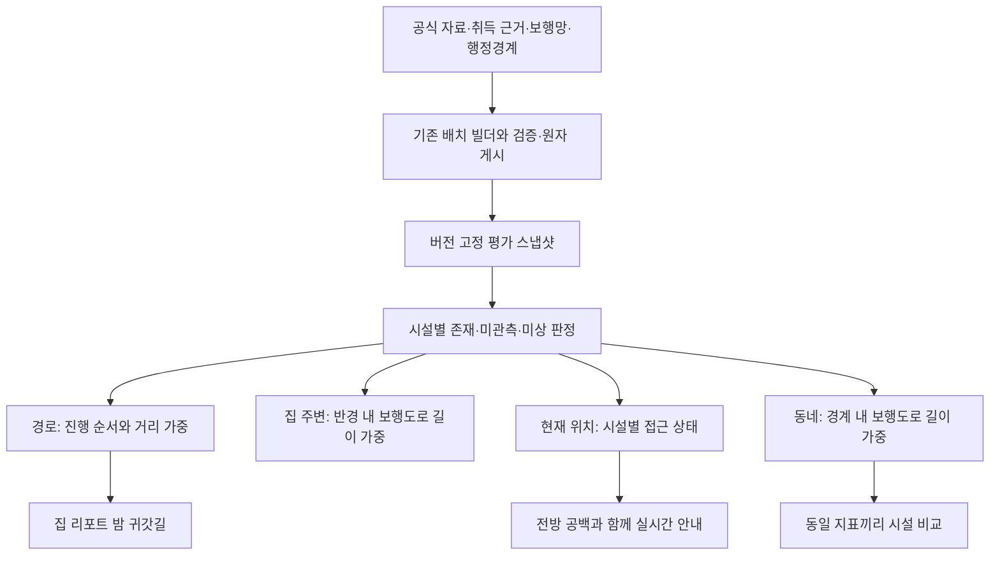

# 시설 접근성 평가 확장 설계

작성일: 2026-11-04 (KST)

상태: 구현 전 제안. 이 문서의 신규 API·파일·수치 목표는 아직 구현되지 않았다.
실행 계획: [단계별 구현 계획](facility-assessment-expansion-plan-2026-11-04.md)

## 1. 목적과 현재 상태

동·도로·시설의 가중 혼합 대신 도입한 시설 접근성 계산을, 같은 성격의 평가가 필요한 다른 기능에도 일관되게 적용한다. 이번 설계의 중심은 계산 모델의 확장이며, 결측 표시만 고치는 작업이 아니다.

| 기능 | 현재 계산·연결 | 변경 목표 |
| --- | --- | --- |
| 길찾기·경로 안내 요약 | `route_environment.py`의 시설 접근 비율·연속 공백 | 기준 계산으로 유지 |
| 집 리포트의 밤 귀갓길 | 새 경로 API 호출 후 이전 `safety_score` 표시 | 실제 새 평가 결과 표시 |
| 집 주변 낮·밤 골목 점수 | `spot_report.area_scores` → 이전 `edge_local_scores`의 50m 격자 평균 | 반경 내 보행도로의 시설 접근 비율 |
| 실시간 안심 거점 안내 | 이전 `point_score`가 40점 미만이면 알림 | 현재·전방 구간의 확인 가능한 시설 공백별 안내 |
| 거주지 추천·관심 동네 비교·지도 | 행정동 통계의 가중 상대 점수 | 별도 보행 시설 비교 기준 추가 |
| 내 정보·출처·관리자 | 이전 경로 가점·감점 설명과 지역 통계 가중치 | 지수별 적용 범위·자료 버전 구분 |

주요 근거: `frontend/src/app/report/page.tsx:53,161,205`, `backend/app/services/spot_report.py:93`, `frontend/src/app/navigate/page.tsx:286`, `backend/app/services/safety_score.py:96`, `frontend/src/app/me/page.tsx:276`.

## 2. 접근 방식과 결정

| 접근 | 장점 | 문제 | 판단 |
| --- | --- | --- | --- |
| 각 화면에 경로 공식을 복사 | 초기 구현이 빠름 | 출처·시간·반경·결측 규칙이 다시 갈라짐 | 제외 |
| 동네 통계 점수까지 경로 점수로 일괄 교체 | 점수 이름이 단순해짐 | 지역 통계와 실제 보행환경의 의미가 달라 기존 순위·관심 알림을 해석할 수 없음 | 제외 |
| 시설 판정·거리 가중 계산은 공통화하고 평가 대상별 집계·표시를 분리 | 모델을 공유하면서 경로·주변·지역의 차이를 설명 가능 | 공통 모듈과 보행도로 색인이 먼저 필요 | 권고안 |

아래의 구현 순서·새 지표 표시 방식·알림 정책 수치는 작성자의 제안이다. 사용자가 이미 확정한 것으로 간주하지 않는다. 실제 제품 코드 변경과 커밋은 이번 설계 작성에 포함하지 않는다.

## 3. 유지할 규칙

- 경기도 서비스 범위, KST 야간 22:00~06:00, 경로 20m 표본, CCTV60m·보안등40m·영업 확인 상점50m·비상벨200m 반경을 유지한다.
- 접근 반경 안의 확인된 시설 유무를 거리 비율로 집계한다. 개수 포화 점수, 유흥업소·공원 감점, 동 점수 혼합을 새 시설 지수에 넣지 않는다.
- 비교 지표 둘 이상은 동일 비중 종합, 하나는 지표 이름이 있는 참고 점수로 표시한다. 부분 자료는 범위와 적용 비율, 아무 근거가 없으면 미상을 유지한다.
- 시설 존재와 검증된 목록에서의 미관측을 구별한다. 좌표가 없는 부분을 시설 부재로 처리하지 않는다. 이 지수는 실제 범죄 확률·조명 밝기·현재 작동 상태를 뜻하지 않는다.
- 편의점이라는 업종만으로 현재 영업·24시간·유인 운영을 인정하지 않는다. 경찰 시설 좌표도 근무 인력·도움 제공 가능 여부의 실시간 확인으로 취급하지 않는다.
- 경로의 5점 후보 허용 차이와 우회 제한 `min(20%,3분)`은 경로 선택에만 적용한다. 동네 순위와 알림에 재사용하지 않는다.
- 기존 거주지 통계 점수에 새 시설 점수를 임의 비중으로 더하지 않는다. 기존 통계 순위와 시설 비교 순위를 구분한다.
- 요청 하나는 시설·보행망·경계·정책이 같은 산출물 스냅샷을 끝까지 사용한다. 새 산출물 로드 중에 버전을 섞지 않는다.

## 4. 공통 평가 구조

### 4.1 공통 모듈의 책임

신규 `facility_assessment.py`에 시설 판정과 가중 집계만 둔다. 기존 `route_environment.py`는 경로 표본 생성, 후보 공통 지표 결정, 진행 거리·공백 계산과 기존 API 형태를 유지하는 어댑터가 된다.

공통 판정 입력은 좌표 목록이며 시설별 `FacilityObservation`을 반환한다. 거리 집계 입력은 `AssessmentSample(sample_id, point, weight)`이며 `weight`는 경로·주변·지역의 보행 길이(m)이다. 현재 위치는 집계 함수를 거치지 않고 `LocalFacilityEvidence`로 시설별 판정만 반환한다. 실제 점 하나를 1m짜리 가짜 경로로 만들지 않는다. 집계 결과의 `scope=route|area|zone`, `weight_unit=metre`를 명시한다.

시설별 판정 결과는 `present`, `absent_in_verified_inventory`, `unknown`이다. 기존 종합 점수에서 쓰던 완전 검증 자료의 존재 판정과 부분 근거의 존재 판정을 내부적으로 구별해, 공통화 때문에 기존 경로 수치가 달라지지 않게 한다.

계산식은 다음과 같다.

- 지표 f의 접근 비율 `C_f = Σ(w_i × 인접시설유무_i,f) / Σw_i`.
- 동일 기준으로 비교 가능한 전 구간 지표 집합 F에서 종합 `100 × ΣC_f / |F|`. 최소 두 지표 조건을 유지한다.
- 단일 지표는 `100 × C_f`를 참고 점수로 반환한다.
- 부분 평가의 하한은 확인된 존재의 가중 합, 상한은 확인된 존재와 미상의 가중 합을 활성 지표 수와 전체 길이로 나눈다. 기존 부분 범위 의미를 유지한다.
- 시설 공백의 연속성은 순서가 있는 경로에서만 계산한다. 서로 다른 골목들을 임의로 이어 주변·동네의 최장 공백을 만들지 않는다.

`FacilityAssessment`는 기존 평가 종류·점수·참고·범위·지표별 적용 비율과 함께 `scope`, `model_version`, `policy_version`, `artifact_version`, `assessed_at`, `reference_at`, `source_versions`, `sampled_length_m`, `comparison_basis_id`, `unavailable_reason`을 갖는다. `LocalFacilityEvidence`는 같은 버전·시각 메타데이터와 좌표·지표별 상태를 가지며 스칼라 점수를 만들지 않는다. 경로 HTTP 필드와 `EnvironmentAssessment`는 기존 호환을 유지한다.

### 4.2 시각과 요일

현재 `routeTimeFor`는 수동 주간·야간을 **2000-01-01 12시·23시**로 보낸다. 요일별 상점 영업시간을 활용할 때 토요일로 고정되는 문제이므로 공통화 단계에서 수정한다.

- `auto`: 서버가 요청 시작 시 현재 KST 시각을 한 번 확정한다.
- 수동 `day`·`night`: 현재 KST 날짜의12시·23시를 보낸다. UTC 날짜를 잘라 쓰지 않는다.
- 집 주변 및 동네의 낮·밤 비교: 요청 KST 날짜의12시·23시를 대표 시각으로 쓰고 화면 상세에도 표시한다.
- 실제 안내의 알림은 서버 현재 KST 시각을 사용한다. 수동12시·23시는 경로 비교/미리보기 기준이다. 안내를 시작할 때 실제 현재 시각으로 선택 경로의 평가만 갱신하며 폴리라인은 유지한다. 안내 화면에는 실제 알림 기준 시각·시간대를 표시한다.
- 현재 위치 요청 캐시는 활성 영업시간 집합이 바뀌는 시각·요일·산출물 교체를 넘겨 재사용하지 않는다.

## 5. 단계별 기능 설계

### 1단계 — 집 리포트의 밤 귀갓길 연결 복구

대상: `frontend/src/app/report/page.tsx`.

`walk.route.safety_score` 대신 첫 대안의 `environment_assessment`, 없으면 응답 최상위의 평가를 사용한다. 기존 `RouteEnvironmentSummary`·`RouteEnvironmentDetails`를 재사용한다. 경로명은 종합 평가가 있을 때만 추천으로 부르고 나머지는 밤 귀갓길로 표시한다. 첫 대안의 거리와 점수는 같은 대안을 참조한다.

Tmap 일반 비교 경로는 ‘일반 비교 경로’라고 표시한다. 실제로 더 짧은지 확인하지 않고 무조건 ‘최단’이라고 부르지 않는다. 경로가 있지만 점수가 없는 상태와 역이 없거나 경로 요청이 실패한 상태를 구분한다.

완료 기준: 새 API가 종합·단일·부분·미상을 반환하는 네 경우에 맞는 표시가 나오고, 경로에 점수가 있는데 이전 필드 때문에 ‘자료 없음’으로 표시되는 일이 없다.

### 2단계 — 공통 시설 판정과 시각 계약 분리

대상: `facility_assessment.py`, 기존 `route_environment*.py`, `frontend/src/lib/preferences.ts` 및 API 타입.

공통화 전후 같은 폴리라인·시각·스냅샷의 종합·참고·범위·공백·후보 순서가 일치해야 한다. 기존 `facility_density.edge_local_scores`로 새 결과를 계산하지 않는다. 이 단계는 새 공식이나 가중치를 도입하는 단계가 아니다.

완료 기준: 기존 경로 회귀 테스트와 대표 경로의 저장된 결과 비교 통과, 수동 시각의 KST 날짜·요일 테스트 통과.

### 3단계 — 주변·지역 평가용 보행도로 색인과 산출물

대상: 신규 `walk_environment_samples.py`, `route_artifact.py`, `safe_route.py`, 빌더·런타임·산출물 검증.

- 경로 후보용 `environment_graph`는 평행 간선을 최단 하나로 줄이고 작은 연결 성분을 제거하므로 주변 집계의 원본으로 쓰지 않는다. 현재 XML 로더도 기본 `retain_all=False`로 고립 성분을 먼저 제거한다.
- 주변 집계 전용 배치 로더 `load_walk_source_for_sampling`은 같은 로컬 XML의 노드·way를 두 번의 순차 읽기로 처리한다. 모든 연결 성분의 형상을 유지하고 자동차 전용·보행 금지 way를 제외해 물리 도로 색인을 만든다. 3단계 실측에서 NetworkX retain_all=True 방식은16.32GB까지 사용해 중단했으며, 별도 전체 그래프를 만드는 방식을 순차 XML 처리로 대체했다. 기존 경로 후보 그래프 생성은 유지한다.
- 새 로더의 캐시 키는 XML해시·파서/필터 코드·표본 알고리즘 버전을 포함하고 기존 경로 캐시와 분리한다. 노드 좌표만 임시 보존하고 완성한 도로 색인을 저장한 뒤 기존 경로 빌드를 진행한다. HTTP 요청 중 OSM 다운로드·전체 그래프 순회를 하지 않는다.
- 같은 도로의 정·역방향 중복을 제거한다. 끝점이 같아도 형상이 다른 보행로는 유지한다. `physical_segment_id`는 정규화한 형상과 원본 도로 식별자로 만든다.
- 공간 색인은 선의 bbox를 대상으로 한다. 중간점만 반경 안에 있는지 검사하지 않는다. 두 끝점이 바깥이어도 반경을 통과하는 도로를 포함한다.
- 주변 평가에서는 원형 범위와 도로를 먼저 자른 뒤 최대20m로 나눠 실제 남은 길이를 가중치로 쓴다. 행정동 평가에서는 동 경계로 먼저 자른다.
- 새 색인·행정동 집계는 schema4 산출물에 저장한다. 리더는 schema3·4의 기존 경로를 읽되, schema3에는 주변·동네 기능 준비 전 상태를 반환한다.
- 원본 SGIS 경계와 서비스의 동 코드599개를 대조한다. 시·군으로 합쳐진 경계나 지도용 단순화 경계로 동별 보행 길이를 추정하지 않는다. 코드 연결 실패·없는 동은 따로 기록한다.
- 기능 준비 상태를 `walking_ready`, `area_environment_ready`, `zone_environment_ready`로 분리한다. 전 지역이 평가돼야만 경로 게시가 가능한 구조로 만들지 않는다. 기존 경로 검증 기준은 유지한다.

행정동 집계는 빌더가 요일0~6의 대표12시·23시 결과를 계산한다. 현재 모델의 시간 의존성이 요일·시간표라는 범위에서만 사용하며, 날짜별 예외 영업 자료가 추가되면 집계 계약을 갱신한다. 결과는 요일·시간대·동 코드·정책·출처 버전과 묶어 보존한다.

원본과 평가 코드·보행망·경계·대표 시각 정책이 바뀌면 fingerprint로 재생성을 요청한다. 새 산출물 전체 검증 후 current를 원자 교체하고 실패 시 기존 current를 보존한다. 리더의3·4 호환을 먼저 배포한 뒤4 생성 기능을 활성화한다.

빌더는 `target_schema`를 명시적으로 전달한다. 새 코드에서 이미 대기 중인 target3 작업은 schema3로 완료하고, 이후 schema4 필요 여부를 검사한다. 버전 상수만4로 바꿔 target3 작업 기록에4 산출물을 붙이지 않는다.

완료 기준: 양방향 도로100m가200m로 계산되지 않고, 경계를 가로지르는 길·분리된 길·보행망 없는 범위를 구별한다. 샘플 수에 상한을 넘기면 조용히 잘라 계산하지 않고 준비 실패 사유를 반환한다.

### 4단계 — 집 주변 300m 보행환경으로 전환

대상: `spot_report.py`, `api/safety.py`, `schemas/safety.py`, 프런트 API·집 리포트.

`GET /safety/spot`에 선택적 `at`을 추가한다. 기존 반경100~1000m, 기본300m를 유지한다. 신규 응답은 다음과 같다.

- `area_environment.day`·`.night`: 해당 반경의 보행도로 평가와 대표 기준 시각.
- `local_environment`: 요청 좌표의 시설별 접근 상태와 평가 시각.
- `facility_observations`: 실제 확인한 시설 좌표 수, 적용 범위, 출처. 전수 목록이 아니면 ‘확인된 N개’로 표시한다.
- `artifact_version`, `status`, `unavailable_reason`: 같은 스냅샷 사용과 준비 상태 확인용.
- 기존 `zone`: 행정동 통계 설명으로 보존한다.

이전 `here_score`, `area_day_score`, `area_night_score`는 새 의미로 채우지 않는다. 계산과 production 소비자는 제거하되 구 화면 탭의 호환을 위해 deprecated·null 필드는 유지한다. 필드 자체의 삭제는 이후 명시적인 API 버전 변경에서 한다. `counts`는 새 데이터에서 계산한 경우에만 반환하고, 이전 로컬 파일 값을 새 평가의 근거처럼 섞지 않는다.

화면은 ‘낮·밤 골목 점수’ 대신 ‘주변 보행 시설 접근성’으로 표시한다. 총 평가 보행 길이와 자료 적용 범위는 접힌 상세에 둔다. 보행망이 없을 때 면적 격자로 되돌리지 않으며, 현재 위치에서 확인 가능한 시설 정보는 별도로 제공한다.

리포트·위치 평가·가까운 시설은 같은 스냅샷을 사용한다. 경찰 시설은 기존 별도 좌표 자료의 버전·출처를 명시하고 종합 시설 점수에는 넣지 않는다. 편의점의 24시간·유인 여부가 미확인이면 그 상태를 표시한다. `load_haven_index`의 프로세스 단위 무기한 캐시는 자료 버전에 따른 캐시로 교체한다.

완료 기준: 주변 시설 자료가 존재하는데 오래된 로컬 파일·동별 제출 플래그 때문에 누락되지 않는다. 반대로 미확인 지역에서 ‘시설 없음’으로 단정하지 않는다.

### 5단계 — 실시간 알림과 안심 거점 판단 전환

대상: `navigate/page.tsx`, `useSafeHaven.ts`, `havens.ts`, 신규 `facility_alerts.ts`.

기존 `here_score < 40` 조건을 제거한다. 현재 선택 경로의 진행 거리와 전방 구간을 같은 시설 근거로 판정한다. 점수 높은 비상벨·CCTV가 보안등 공백을 상쇄하지 않게 한다.

| 확인 상태 | 안내 |
| --- | --- |
| 야간 보안등·영업 확인 상점 모두 확인 가능하고 둘 다 비인접 | ‘공개 자료상 조명·영업 시설 접근 공백’ 안내 |
| 보안등은 확인 가능하나 상점 영업 자료는 미상 | 보안등 접근 공백만 구체적으로 안내. 조명·상점 전체 공백이라고 부르지 않음 |
| 보안등 또는 확인된 영업 시설이 인접 | 해당 시설 상태 표시. 종합 점수로 어둡다고 판정하지 않음 |
| 두 자료 모두 미상 | 자동 위험 경고 없이 미확인 상태 표시. 확인된 가까운 시설 조회는 유지 |
| 주간 | CCTV 접근 정보 등 주간 근거를 표시하며 야간 조명 경고를 재사용하지 않음 |

제안 초기 알림 정책은 전방200m 관측, 연속 확인 공백100m에서 발생,60m 미만으로 해소되면 해제, 같은 공백 음성 재알림은180초 이후이다. 현재 위치가 공백 안이거나 공백 시작20m 이내인 경우에만 음성·진동을 낸다. 공백ID는 경로ID·지표 종류·원래 진행 거리 구간으로 구성해 전방 창 이동마다 바뀌지 않게 한다. 이전 활성 상태·직전 음성 시각을 보존해 발생/해제/재알림을 판단한다. 보정된 위험 임계값이 아닌 시제품 정책이며 별도 버전으로 기록한다.

위치 변경에 따른 요청 제한40m 이동·15초 경과는 유지한다. 다만 평가 유효기간이 끝나면 정지 중이어도 갱신하며, 최소15초 재요청 제한 때문에 즉시 갱신할 수 없으면 근거 만료 상태로 알림을 억제한다. 안내 종료·현재 경로 이탈40m 초과·재탐색 중에는 기존 공백 알림을 억제한다. 경로·시간대·산출물 교체 시 공백 식별과 알림 상태를 초기화한다. 오래된 응답이 최신 위치 상태를 덮지 않게 요청 순서를 검사한다.

신규 `POST /safety/route-environment`는 선택 폴리라인과 선택적 현재 위치를 받아 형상을 바꾸지 않고 최신 평가·알림 근거·가까운 시설을 반환한다. 공개 경로 API와 같은 서비스 범위·요청 제한을 적용한다. 제안 입력 한도는 좌표5000개·총 길이20km이며, 초과 시 안내 자체는 보존하고 평가 불가 사유를 표시한다.

응답의 `route_evidence`는 지표별 `{start_m,end_m,state}` 연속 구간이며 unknown 구간도 생략하지 않는다. 같은 응답의 `local_environment`와 동일한 snapshot·실제 평가 시각을 사용한다. `evaluated_at`, `valid_until`, `temporal_key`를 함께 반환한다. 유효기간은 현재+60초, KST22시/06시/자정, 경로·현재 위치 주변의 상점 시간표가 다음 열림/닫힘으로 바뀌는 시각 중 가장 이른 때다. 현재 닫힌 매장의 다음 열림도 계산한다. 자정을 넘기는 시간표와 전날 요일을 포함한다. 실제 영업 확인을 뜻하지 않는다.

API는 이 유효기간이 지난 경로·지점 근거를 재사용하지 않는다. 화면은 경로 근거와 지점 근거의 snapshot·temporal_key가 일치하고 둘 다 유효할 때만 자동 알림을 낸다. 구 평가 결과에는 해당 메타데이터가 없으므로 첫 안내 시 갱신한다.

경로 전달의10분 유효기간만으로 출처 최신성을 판단하지 않는다. `GuideOption`/handoff에 산출물·평가 기준을 보존하고, 스냅샷이 달라지면 기존 경로의 형상을 유지한 채 평가를 갱신한 뒤 알림한다. 새 평가를 못 받으면 지난 점수로 위험을 단정하지 않는다.

가까운 시설의 거리순 조회는 유지하되 ‘사람이 있는 곳’·‘24시’는 검증된 때만 표현한다. API에 좌표가 없다는 이유로 ‘1.5km 안에 시설이 없다’고 단정하지 않고 ‘자료에서 확인하지 못함’으로 표시한다.

완료 기준: 종합 점수가 높아도 확인된 조명 공백은 놓치지 않고, 자료 미상이거나 이전 경로·이전 위치의 공백으로 반복 경고하지 않는다.

### 6단계 — 거주지 추천·동네 비교·지도에 별도 시설 기준 추가

대상: 지역 시설 집계 서비스, `api/safety.py`, 홈·비교·지도·관심 동네.

기존 통계 점수는 ‘지역 통계 지수’, 신규 값은 ‘보행 시설 접근성’으로 구분한다. 제안 기본값은 기존 지역 통계이며, 사용자가 평가 기준을 전환한다. 하나의 혼합 점수로 합산하지 않는다.

신규 `GET /safety/facility-zones?period=day|night&basis_id=...`는 전체 동의 시설 평가, 비교 가능한 집합, 집합 내 순위를 반환한다. `GET /safety/zones/{dong_code}`에는 `facility_environment.day/night`를 추가한다. 동네 비교는 같은 `basis_id` 자료를 요청한다.

`basis_id`는 공통 지표 집합·시간대·대표 시각·요일·모델·정책·보행 집계/경계 버전이라는 비교 의미로 결정하고, `artifact_version`과 출처 해시는 포함하지 않는다. 같은 응답의 비교에는 별도 `result_group_id=hash(basis_id,artifact_version,source_versions)`를 적용해 자료 세대를 섞지 않는다. 전 구간 지표 집합이 같은 동끼리만 순위를 산정한다. 기본 비교 집합은 종합 지표가 둘 이상인 집합 중 동 수가 가장 많은 집합이며, 동 수가 같으면 정렬된 지표 이름으로 결정한다. 점수가 높은 집합을 골라 기본값으로 삼지 않는다.

기본 `basis_id` 요청을 생략하면 위 규칙으로 선택한다. 저장된 basis_id가 현재 요일·정책에서 더 이상 유효하지 않으면 `409 comparison_basis_changed`와 현재 가능한 집합을 반환하며 다른 집합으로 조용히 바꾸지 않는다. 화면은 현재 비교 기준을 다시 선택하도록 표시한다.

다른 집합의 동·단일 참고·부분 범위·미상도 표시하되 순위는 붙이지 않는다. 종합 지표 둘 이상인 집합이 하나도 없으면 선택 basis는null, 비교 집합은빈 목록으로 응답하고 전체 동의 확인 가능한 정보는 동 이름·코드 순으로 제공한다. 순위는 ‘동일 지표 비교 N개 동 중 M위’로 표기한다. 경기도 전체 순위라는 이름을 재사용하지 않는다. 같은 표시 점수는 공동 순위로 두고 동 코드로 표시 순서를 고정한다. 자료가 충분한 지역만 남겨 전체 지도에서 다른 지역을 지우지 않는다.

서로 다른 두 동을 비교할 때는 각자 다른 종합 점수의 우열을 칠하지 않는다. 공통 지표가 둘 이상이면 그 집합으로 재집계하고, 하나면 해당 참고 비율, 없으면 지표별 확인 정보만 나란히 보여준다.

지도 색상·툴팁·순위·관심 동네 카드가 선택한 기준과 같은 값을 사용한다. 부분·미상은 중립 색, 단일 참고는 종합 안전 등급 색을 사용하지 않는다. 현재70/40 색 구간은 시설 접근 비율의 표시 구간으로만 쓰고 안전 확률로 설명하지 않는다.

기존 관심 동네 저장값은 `metric=regional_statistics`로 마이그레이션한다. 시설 알림은 `metric`, `period`, `basis_id`, `artifact_version`, `model_version`, `policy_version`, `schedule_key`를 함께 저장한다. 모델·정책·비교 기준·요일이 바뀐 점수 차이는 환경 변화 알림으로 내보내지 않는다. 같은 비교 의미에서 자료가 갱신된 경우에만 ‘공개 자료 기준 점수 변경’으로 설명한다.

완료 기준: 지역 통계와 시설 접근성이 섞이지 않고, 지도 색·카드·비교·알림이 같은 기준을 가리킨다.

### 7단계 — 설명·관리자·이전 코드 정리

- 각 기능을 바꾸는 단계에서 해당 화면의 설명도 함께 바꾼다. 마지막 단계까지 잘못된 설명을 방치하지 않는다.
- `/data`와 `/me`에 지역 통계·보행 시설 지수의 정의, 적용 대상, 기준 시각·출처, 보행망 한계를 구분한다. 기존 ‘모든 편의점은 야간 가점’·유흥업소/공원 감점 설명을 새 경로 안내에서 제거한다.
- 최신 공식 수집과 기존 거주지 통계 자료의 기준일·조사 범위를 별도로 표시한다. 한쪽 갱신만으로 다른 쪽 자료도 최신이라고 적지 않는다.
- 관리자 가중치 화면은 지역 통계 프로필임을 표시한다. 이번 범위에서 시설 반경·알림 임계값을 편집하는 새로운 관리자 화면은 만들지 않는다. 시설·알림 정책 버전과 산출물 적용 상태는 조회 가능하게 한다.
- 모든 호출자가 전환된 후 `spot_report`의 이전 `edge_local_scores` 연결과 프런트의 구 필드 소비를 제거한다. deprecated·null 응답 필드는 위 호환 계약에 따라 유지한다. 이전 함수가 테스트·비교용으로 남으면 production 호출이 없는지 검색한다.
- `DEVELOPMENT.md`, 산출물 상태 설명, 운영 스모크의 점수·경로 계약을 갱신한다. 경로 자체가 없는 경우·보행만 가능한 경우·시설 평가까지 가능한 경우를 구별한다.

## 6. 성능·운영·실패 처리

- 반경 조회는 준비된 공간 색인과 bounded cache만 사용한다. 캐시 초기 한도128건·256MB는 제안값이며 측정 후 확정한다.
- 제안 검증 목표: 기존 적재 그래프 기준 warm 주변300m 평가 p95 1초 이내,1000m 2초 이내. 장비·샘플 수·전후 지연·메모리를 함께 기록하고 미달 시 색인/캐시를 조정한다. 임의 도로 절단으로 맞추지 않는다.
- 동네 집계는 요청 시599개 동의 도로를 다시 읽지 않고 배치 결과를 조회한다. 지역별 실패가 다른 정상 지역 결과를 지우지 않는다.
- 새 산출물 미준비·보행망 없음·경계 매칭 실패·지표 근거 부족을 서로 다른 reason으로 표시한다. 구 점수로 조용히 복귀하지 않는다.
- 보행망의 공간 범위·원본 날짜를 표시한다. 주변·동네 지수는 OSM에서 확보한 보행로 기준이며 현실의 모든 골목을 전수조사한 결과가 아니다.
- 새 기능 실패는 경로 안내 자체를 중단시키지 않는다. 버전 불일치 때 기존 경로를 보존하고 수치·경고를 준비 상태로 전환한다.
- UI/API/빌더 계약을 함께 배포한다. 데이터 파일은 재생성 대상이며 원본·대용량 생성물을 Git에 추가하지 않는다.
- 4단계의 구here_score 무효화와5단계의 알림 전환은 한 배포 단위로 적용한다. 구현·검토는 분리하되4단계만 먼저 운영 배포해 기존 알림이 조용히 사라지게 하지 않는다.

## 7. 검증과 완료 조건

공통 회귀는 기존 경로 수치·선택 순서 보존, 시간대·요일, 부분/미상/알려진0, snapshot 교체 경쟁을 포함한다. 공간 검증은 정·역방향 중복, 반경을 가로지르는 긴 간선, 동 경계 절단, 서로 다른 평행 보행로, 고립된 도로, 빈 보행망을 포함한다.

화면 검증은 집 리포트 네 평가 종류, 실시간 경고의 근거·반복 억제, 기준 전환 시 지도/순위/비교/관심 알림 일치를 포함한다. 기존 모바일 카드 크기와 접힌 상세 원칙을 유지한다.

실제 지역 검증은 사용자 제공 화성 반정동92-2→수원 권광로109번길12와 수원·화성·부천·광명·김포·안양의 주간/야간을 재사용한다. ‘모든 곳 점수 산출’을 합격 조건으로 삼지 않고 확인 근거와 계산·표시가 일치하는지 확인한다.

전체 완료는 일곱 단계와 기반 산출물 전환이 끝나고, 현재 사용자 기능에서 이전 시설 가중합이 호출되지 않으며, 신규 API·프런트·배치·설명·운영 검증이 같은 모델을 가리킬 때로 정의한다. 기존 지역 통계 지수의 존치는 의도한 별도 기능이다.
