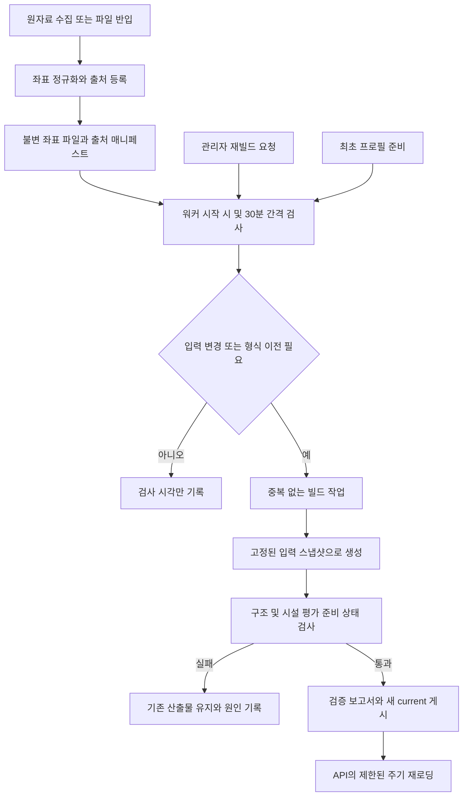

# 경로 시설 자료 연결과 산출물 자동 갱신 설계

작성일: 2026-11-04 · 상태: 최초 조사·설계 기록 / 후속 구현 상태는 아래 적용 기록 참고

> 후속 적용 기록(2026-11-04): 사용자가 완전 전환과 서버 시작 시 자동 생성을 승인했다. 이에 따라 단계적 feature flag 대신 경로 API를 새 방식으로 고정하고 API 수명에 빌더를 연결했다. 아래 본문은 구현 전 조사·제안 기록이며, 현재 구현은 `DEVELOPMENT.md`, 검증·미완료 자료 조건은 실행 ledger를 따른다. 기존 좌표의 검증되지 않은 출처·완전성·영업시간은 계속 미상으로 보존한다.

## 1. 결론

기존 시스템에는 **별도 워커를 실행했을 때 입력 변경을 감지하여 재생성하는 기능**이 있다. 매 30분마다 무조건 산출하는 구조는 아니다. 공공데이터를 자동으로 수집하는 기능과도 구별된다.

현재 확인한 로컬 환경은 워커가 없고 활성 프로필도 없어 자동 갱신이 작동할 조건을 충족하지 않는다. 프런트엔드와 API를 실행하는 것만으로 빌더가 시작되지는 않는다. 따라서 이 환경에서는 초기 설정과 별도 배치 실행이 필요했다. 과거 원격 서버에서 워커가 계속 가동했는지는 로컬 조사만으로 판정하지 않는다.

이번 문제는 산출물 재생성만 실행한다고 모두 해결되지 않는다. 시설 출처 매니페스트가 없는 상태로 새 산출물을 만들면, 형식은 새 버전이어도 시설 평가 입력은 비어 있을 수 있다.

## 2. 기존 동작과 현재 실행 상태

### 2.1 코드에 있는 기능

| 진입점 | 기존 동작 | 실행 조건과 한계 |
| --- | --- | --- |
| `backend/scripts/build_route_artifacts.py` | DB의 서비스 범위 안전구역과 로컬 보행망으로 한 번 빌드하고 게시 | 운영자가 별도로 실행. 일반 실행 경로는 코드 기본 프로필을 사용하며 DB의 활성 프로필을 자동 조회하거나 빌드 이력을 남기지 않음 |
| `backend/scripts/artifact_builder_worker.py` | 대기열 처리, 게시 결과 복구, 활성 산출물의 입력 변경 확인 | 별도 상주 프로세스 필요. 기본 대기열 확인 10초, 입력 변경 확인 1,800초 |
| `queue_rebuild_if_active_artifact_is_stale` | 활성 프로필과 산출물의 프로필·데이터 지문 비교 후 재생성 요청 | 활성 프로필이 없으면 즉시 종료. 산출물만 수동으로 게시해도 활성 프로필이 자동 등록되지는 않음 |
| 관리자 프로필 적용 API | 빌드 작업을 대기열에 등록 | API 자체는 무거운 빌드를 하지 않으며 워커가 필요 |
| `docker-compose.yml`의 `artifact-builder` | 워커를 별도 서비스로 실행하고 종료 시 재시작 | Docker 엔진과 해당 서비스가 실제 실행 중이어야 함 |
| `run_app.cs` | API와 프런트엔드 실행 | 빌더 실행 없음 |
| `backend/app/main.py` | 시작 시 기존 산출물 로드 | 원자료 수집·경로 재빌드·워커 실행 없음 |

워커는 시작 직후에도 변경 검사를 수행하지만, 현재는 활성 프로필 부재로 이 검사가 실질적인 작업을 등록하지 못한다. 빌드는 동기 작업이므로 10초·30분은 실행 지연을 포함하는 검사 간격이지 엄격한 완료 시각 보장이 아니다.

### 2.2 현재 PC에서 확인한 사실

| 조사 항목 | 결과 |
| --- | --- |
| 실제 산출물 경로 설정 | `backend/data/production/route_artifacts` |
| current 버전 | `20261013T235042Z`, schema 2, profile `default-v3` |
| 해당 버전 디렉터리 | 한 개 확인. 마지막 기록은 2026-10-14 KST |
| DB `scoring_profiles` / `score_builds` | 모두 0행 |
| 실행 중인 Python 빌더 워커 | 확인되지 않음 |
| 프로젝트 관련 Windows 예약 작업 | 확인되지 않음 |
| Docker 엔진 | 로컬 named pipe 연결 실패. 컨테이너 실행 여부는 조회할 수 없었음 |
| 새 시설 출처 매니페스트 | 설정된 파일 없음 |
| 새 모델 스위치 | `false` |

파일 시각이나 버전명은 누가 어떤 명령으로 만들었는지 증명하지 않는다. 수동 실행 이력이 DB에 기록되지 않는 기존 경로도 있으므로, DB 0행을 과거 빌드가 한 번도 없었다는 뜻으로 해석하지 않는다.

### 2.3 점수 미산정의 직접 원인

1. 현재 schema 2 산출물은 새 시설 평가용 `environment_snapshot()`을 제공하지 않는다.
2. API는 snapshot이 없으면 빈 `EnvironmentIndex()`로 새 평가를 실행한다.
3. 낮의 CCTV·상점·비상벨, 밤의 CCTV·보안등·상점·비상벨 모두 사용 지표에서 빠진다.
4. 두 개 이상 공통 지표가 있어야 점수를 계산하므로 모든 새 점수가 `null`이다.
5. 화면은 기존 혼합 점수가 아닌 새 시설 점수를 표시하여 `점수 미산정`이 나온다.

스위치가 꺼진 사실은 새 기준으로 후보를 선택하지 않는 이유다. **스위치가 꺼졌다는 이유만으로 평가 점수가 항상 null이 되는 것은 아니다.** 새 인덱스가 있으면 비활성 상태에서도 shadow 평가가 가능하다.

수원·파주, 낮·밤 4개 요청의 12개 대안에서 사용 지표 0개와 새 점수 null을 재현했다. 기존 점수는 계속 반환된다.

## 3. 자료 현황과 포함 범위

아래는 전체 로컬 파일의 레코드 수이며 특정 경로 주변 수, 경기도만의 수 또는 중복 제거한 시설 수를 보장하지 않는다. 기존 시설 로더로 인덱스 생성이 가능한 것까지 확인했다.

| 새 평가 항목 | 기존 입력 | 레코드 수 | 연결 시 필요한 처리 |
| --- | --- | ---: | --- |
| CCTV | `facility_points.json:cctv` | 84,908 | 원본·목적·기준일·조사 범위 확인. 방범 목적을 근거 없이 일괄 지정하지 않음 |
| 보안등 | `facility_points.json:lights`, `lights_geocoded` | 525,249 + 78,878 | 직접 좌표와 지오코딩 좌표 출처 분리, 좌표 검증 및 중복 처리. 야간 평가 대상 |
| 상점 | `store_points.json:stores` | 297,312 | 상점 존재와 해당 시간 영업 여부를 분리 |
| 편의점 | `store_points.json:convenience` | 14,630 | 편의점 분류만으로 24시간 영업으로 확정하지 않음 |
| 비상벨 | `bell_points.json` | 58,767 | 지도와 평가가 같은 정규화 좌표·자료 버전을 참조하도록 연결 |

사고다발지역·유흥업소·공원·경찰 시설은 기존 로직의 별도 입력이다. 이번 설계에서 새 지수의 요인이나 가중치를 확대하지 않는다. 거주지 점수 및 경로에서 동 점수를 제외한 정책도 변경하지 않는다.

## 4. 선택한 방식

| 방식 | 장점 | 문제 | 판단 |
| --- | --- | --- | --- |
| 기존 워커와 대기열 확장 | 게시·복구·프로필 구조 재사용, 변경 있을 때만 빌드 | 최초 초기화와 입력 준비·상태 표시 보완 필요 | **권장** |
| OS 예약 작업이 매일 빌드 명령 실행 | 시작은 간단 | 무변경 재빌드, 중복 실행, 활성 프로필·실패 이력 문제 유지 | 주 실행 경로로 사용하지 않음 |
| API 시작 때마다 전체 재생성 | 별도 명령 누락 감소 | 서버 시작 지연, 다중 API 프로세스 중복, 데이터 수집 의존 | 사용하지 않음 |

새 작업 플랫폼을 추가하지 않고 단일 builder를 기본 운영 형태로 삼는다. 로컬과 Docker가 같은 준비·검사·빌드·게시 함수를 사용한다.

## 5. 제안 아키텍처

### 5.1 수집·자료 준비·산출물 생성을 분리

- **원자료 수집:** 기존 수집·적재 스크립트의 책임이다. 원격 API 다운로드 주기는 출처별 갱신 주기·호출 한도에 맞춰 별도 설정한다. 30분 빌더 검사를 공공데이터 30분 재수집으로 바꾸지 않는다.
- **자료 준비:** 파일 반입 또는 수집 성공 후 정규화 좌표와 출처 정보를 만든다. 초기 기존 파일 반입은 별도 일회성 절차로 제공한다. 반복 준비는 내용 지문이 바뀐 파일만 처리한다.
- **산출물 빌드:** 준비된 자료와 DB·보행망·정책 지문을 확인하고 변경이 있을 때 수행한다. 외부 수집은 HTTP 경로 요청에서 실행하지 않는다.

원격 자동 수집은 이번 1차 구현의 필수 범위가 아니다. 기존 파일을 연결하고 변경 후 자동으로 다시 빌드되는 상태를 먼저 완성한다. 자동화로 확인되지 않은 출처·완전성·영업시간을 만들어내지 않는다.

### 5.2 기존 시설 파일의 연결

`backend/app/services/route_environment_inputs.py`를 신설해 기존 좌표 형식을 새 입력으로 바꾸는 책임을 둔다. 대용량 변환 실행은 `backend/scripts/prepare_route_environment_inputs.py`에서 한다.

- 어댑터는 파일·JSON 키·좌표 순서·좌표계·유효 범위·출처 식별자를 명시한다.
- 출처 설명은 별도 관리 파일 `backend/data/route_source_catalog.json`에 둔다. 비밀값을 넣지 않으며 확인된 사실과 미확인 항목을 구분한다. 이번 설계 작성 단계에서는 이 파일의 출처 값을 임의로 채우지 않는다.
- 정규화 산출물은 운영 쓰기 가능 경로 `backend/data/production/route_sources/`에 보관한다. Docker에서는 `/data/route_sources/`이다.
- 입력 좌표를 내용 해시 이름의 불변 파일 `objects/<sha256>.json`로 저장한다. 매니페스트의 `points_file`은 같은 루트 아래 상대 경로를 사용한다. 기존 로더의 경로 제한을 완화하지 않는다.
- 매니페스트는 기존 schema 1을 재사용한다. `ROUTE_ENVIRONMENT_SOURCES_PATH`를 로컬과 Docker에서 각각 준비 경로로 설정한다.
- 임시 파일 검증 후 원자적으로 매니페스트를 교체한다. API와 빌더가 서로 다른 입력 세대를 섞지 않도록 빌드는 읽은 매니페스트와 파일 해시를 고정한다.
- 비상벨 지도 조회도 같은 정규화 자료 버전을 참조하도록 조정한다. 전환 전에는 레거시 파일 폴백을 명시하고 자료 버전 불일치를 상태로 알린다.

### 5.3 자료 존재와 종합 점수 적격성을 구분

현재의 `verified_complete_coverage_required` 하나로 모든 상황을 표현하지 않는다. 준비 결과에 다음 정보를 따로 기록한다.

| 상태 | 뜻 | 표시·계산 |
| --- | --- | --- |
| `source_missing` | 입력 파일 없음 | 제외 사유로 표시 |
| `invalid_coordinates` | 좌표 형식 또는 좌표계 검증 실패 | 해당 자료 사용 차단 |
| `provenance_unverified` | 좌표는 있으나 원본·목적 등의 확인 부족 | 확인된 좌표 존재와 검증 상태 구분 |
| `coverage_unverified` | 조사 범위의 완전성 미확인 | 확인된 시설 접근 정보는 제공 가능하나 부재를 단정하지 않음 |
| `opening_hours_unverified` | 상점 위치는 있으나 시간별 영업 근거 없음 | 상점 존재를 현재 영업으로 바꾸지 않음 |
| `outside_source_coverage` | 검증 자료가 있으나 해당 경로와 반경을 포괄하지 못함 | 해당 요청의 공통 요인에서 제외 |
| `eligible` | 기존 점수 정책의 출처·범위·목적·시간 조건 충족 | 비교 경로에 공통으로 적용 |

`provenance_unverified` 등은 준비 진단 상태이며 매니페스트의 `completeness` 열거값을 무단 변경하지 않는다. 기존 `provenance_only/partial/verified_complete/missing`과 별도 사유를 함께 사용한다.

부분 자료의 시설 존재·접근 정보와 종합 점수는 구분한다. **이번 설계는 두 개 이상 공통 적격 요인이라는 점수 규칙을 유지한다.** 검증된 지표가 부족하면 실제 숫자 점수 복구가 지연될 수 있으며, 이를 빌드 자동화만으로 해결됐다고 보고하지 않는다. 부분 자료를 점수에 직접 포함하는 정책은 별도 모델 의미 버전과 검증이 필요한 후속 과제다.

### 5.4 최초 초기화와 명령 경로 통합

- 활성 프로필이 없는 경우 더 이상 조용히 종료하지 않고 `bootstrap_required`를 남긴다.
- 현재처럼 코드 기본 프로필 `default-v3` 산출물이고 DB가 비어 있는 환경은, **기본 프로필을 draft로 멱등 등록하고 최초 빌드를 요청**할 수 있도록 한다. 검증된 새 산출물 게시 성공 후에만 active로 전환한다.
- 기존 산출물이 알 수 없는 사용자 정의 프로필이면 기본값으로 덮어쓰지 않고 `profile_unresolved`로 중단한다. 관리자에게 프로필 복원을 안내한다.
- 기본 프로필의 버전뿐 아니라 실제 가중치와 unknown 정책의 지문도 입력에 포함한다.
- 일회성 수동 빌드도 같은 대기열·프로필 선택·기록 함수를 사용한다. 활성 프로필이 있는데 수동 명령이 기본 프로필을 조용히 게시하는 동작을 없앤다.
- 일회성 명령에는 `--check-only`, `--bootstrap`, `--process-next`, `--force`를 분리한다. `--force`는 변경 없음 검사만 우회하며 출처 검증·게시 검사·실행 잠금을 우회하지 않는다. 위 옵션 중 신규 옵션은 아직 구현되지 않았다.

### 5.5 변경 감지와 중복 방지

기본 10초 대기열 처리와 30분 변경 검사 설정을 재사용한다. 워커 시작 때 최초 검사를 한다.

재생성 조건은 산출물 부재·손상, schema 2에서 3으로의 이전, 입력 지문 변경, 점수·시설 정책 버전 변경, 관리자 명시 요청이다. 단순 시간 경과나 파일 mtime 변경만으로 전체 재생성을 반복하지 않는다.

입력 지문에는 실제 소비하는 DB 지표·점수 프로필·보행망 원본/전처리 의미·시설 출처 매니페스트·모든 사용 좌표 파일·시설 정책을 포함한다. 현재 지문은 보행망 원본을 직접 포함하지 않으며, 비상벨 원본도 새 출처 목록에 등록되지 않으면 직접 감지하지 못한다. 의존성 목록을 실제 빌드 입력과 통일한다.

`(profile_fingerprint, input_fingerprint, region, target_schema)`가 같은 queued/building 작업은 하나만 유지한다. 변경 중인 파일에서 해시와 실제 빌드 내용이 달라지지 않도록 준비된 불변 입력 세트를 사용한다. 큰 파일 지문 확인은 워커가 담당하며 API 요청에 이 비용을 넣지 않는다.

### 5.6 검증·게시·실패 처리

검사는 다음 두 층으로 분리한다.

1. **구조 준비:** 경기도 서비스 범위, 정상 보행 그래프, schema 3, 정책 지문, 좌표 파일 해시, 입력 세대 일치.
2. **평가 준비:** 요인별 입력 수·유효 수·제외 사유·검증 범위, 승인된 낮·밤 기준 경로의 공통 사용 지표 수와 점수 산출 여부.

구조 통과만으로 `점수 준비 완료`를 표시하지 않는다. 결과 보고서 `validation.json`에는 두 상태와 실제 평가에 쓰인 자료 버전을 기록한다. 모든 요인이 빠지는 산출물의 구조적 빌드는 가능해도 평가 활성화를 허용하지 않는다.

- 초기 도입은 기존 보행 안내를 유지하고 검증 보고서를 후보 산출물로 확인한다. 평가 활성화 단계에서는 합의한 기준 경로의 낮·밤 평가가 준비된 후보만 게시한다.
- 이미 평가 가능한 산출물을 운영 중이면 입력 손상·전 지표 제외 등으로 준비 상태가 후퇴한 후보를 자동으로 current로 승격하지 않는다. 기존 버전을 유지하고 오류 상태를 기록한다.
- 정상 후보는 기존 임시 디렉터리 저장 → 검증 → 버전 디렉터리 확정 → `current.json` 원자 교체를 재사용한다.
- 단일 builder 운영을 기본으로 하고, 수동 명령과 워커 모두 같은 산출물 디렉터리 실행 잠금을 사용한다. DB 작업 claim은 조건부 갱신으로 중복 획득을 막는다.
- 중단된 building 작업은 재시작 때 게시 버전·작업 ID·입력 지문을 대조해 성공 복구 또는 재시도 가능 실패로 정리한다. 프로필 버전만 일치한다고 다른 작업을 성공 처리하지 않는다.
- 워커의 검사 예외가 상주 루프 전체를 조용히 끝내지 않도록 단계별 오류와 재시도 시각을 남긴다. 일시 오류는 지수형 간격으로 재시도하고, 잘못된 출처 입력은 입력 변경 또는 명시 재시도 전까지 같은 빌드를 반복하지 않는다.
- `current` 교체 전 입력 세대가 바뀌었으면 낡은 후보의 승격을 막고 최신 작업으로 합친다.

### 5.7 운영 상태와 화면

API의 기존 `/health`는 보행 안내 가용성에 대한 간단한 응답을 유지한다. 별도 준비 상태 필드 또는 관리용 상태 API에 아래를 제공한다. 상세 경로·원본 파일 경로·개인 좌표·비밀값은 공개하지 않는다.

- 사용 중인 산출물 버전·형식·게시 시각
- `last_worker_heartbeat_at`, `last_checked_at`, `last_success_at`, 현재 작업 상태
- 소스 수·요인별 레코드 수·제외 사유와 `source_snapshot_id`
- `walking_ready`, `environment_inputs_ready`, `environment_ready`, `environment_model_applied`
- `stale_reason`: 워커 미동작, 초기화 필요, 입력 변경 대기, 자료 검증 부족, 빌드 실패 등

기존 산출물 재로딩은 요청당 무제한으로 하지 않고 기존 제한 주기를 유지한다. 새 버전 로드 검증에 실패하면 메모리의 정상 버전을 유지한다.

사용자 화면은 시간·거리·작은 점수 배지와 접힌 상세 정보를 유지한다. 자료가 연결돼 있으나 범위 확인이 안 된 경우와 평가 시스템이 미준비인 경우를 상세에서 구별한다. 동 점수나 예전 혼합 점수를 새 시설 점수로 대체 표시하지 않는다.

### 5.8 로컬·Docker 실행

- **로컬:** 기존 런처에 명시적인 builder 실행 옵션을 추가한다. 기본 서버 실행에 대용량 최초 빌드를 무조건 끼워 넣지 않는다. 별도 `python -m scripts.artifact_builder_worker` 실행도 지원한다. 로컬 전용 DB/산출물과 운영 경로를 실행 시 표시하고 교차 사용을 방지한다.
- **Docker:** 기존 `artifact-builder` 서비스를 재사용한다. API와 builder는 같은 DB·산출물·정규화 출처 경로를 사용한다. 원본 `/app/data/osm`은 읽기 전용, 정규화 출력 `/data/route_sources`는 builder만 쓰고 API는 읽기 전용으로 소비한다. 현재 API의 전체 `/data` 쓰기 마운트가 필요하다면 서비스별 필요한 하위 디렉터리 권한으로 조정한다.
- 워커 heartbeat로 상주 여부를 판단한다. 프로세스가 떠 있다는 사실만으로 source 준비와 최근 빌드 성공을 간주하지 않는다.
- 공공데이터 수집 스케줄은 별도 도입 시 출처별 설정한다. 이번 작업에서 Windows 예약 작업 설치나 원격 배포 변경은 수행하지 않는다.

## 6. 구현 순서와 변경 파일

1. **입력 연결:** `route_environment_inputs.py`, 준비 배치, 출처 관리 파일 형식과 기존 매니페스트 작성기 확장. 실제 자료가 무엇 때문에 제외되는지부터 보이게 한다.
2. **최초 빌드·기록 통합:** `build_route_artifacts.py`, `scoring_profile_store.py`, 필요 시 빌드 모델/스키마·기존 스키마 보정. 기본 프로필 초기화와 수동/자동 진입점 통합.
3. **워커 보완:** `artifact_builder_worker.py`, `safe_route.py`의 입력 지문, 잠금·중단 작업 복구. 변경 없으면 빌드하지 않는 동작 유지.
4. **게시와 준비 검사:** `route_artifact.py`, `route_environment_sources.py`, 검증 보고서. 빈 평가가 정상 활성화로 보이지 않도록 한다.
5. **실행·관측·화면 연결:** `docker-compose.yml`, `run_app.cs`, 설정 예시, 관리용 상태 API 및 프런트 타입·상세 표시, 비상벨 지도와 평가 자료 버전 일치. `DEVELOPMENT.md` 갱신.

기존 파일의 대규모 재수집이나 원격 게시를 설계 작성 단계에서 실행하지 않는다. 실제 대형 빌드의 시간·메모리는 1회 측정 후 운영 자원 한도를 정하며 추정치를 성능 결과로 쓰지 않는다.

## 7. 완료 기준

| 검사 | 기대 결과 |
| --- | --- |
| DB가 비고 기본 schema 2 산출물만 존재 | bootstrap 필요를 노출하고 멱등 초기화 후 한 번만 이전 작업 등록 |
| 활성 프로필 존재 + 수동 빌드 | 같은 프로필과 작업 기록을 사용. 기본 프로필로 조용히 교체하지 않음 |
| 같은 입력으로 반복 검사 | 중복 빌드 0건 |
| 비상벨·CCTV·보안등·상점 중 실제 사용 파일 하나 변경 | 해당 변경을 감지해 한 작업 등록 |
| 보행망 또는 정책 변경 | 변경 지문으로 새 산출물 생성 |
| 출처 파일 위변조·좌표 오류·영업시간 미확인 | 서로 다른 원인 표시. 근거 없는 완전 자료·현재 영업으로 승격 금지 |
| 낮·밤에 적격 지표가 두 개 이상인 검증 fixture | 추천·대안·비교의 공통 지표와 점수 산출 확인 |
| 실제 승인 지역 기준 경로 | 실제 자료로 평가 준비를 확인한 경우에만 적용. fixture 통과로 대신하지 않음 |
| 지도와 평가의 비상벨 자료 | 같은 좌표 세대 식별. 자료는 있는데 시스템 미연결인 상태를 구분 |
| 실패 또는 빌더 중단 | 정상 current 보존, 오류 이력, 재시작 후 작업 회복 |
| 서버만 실행하고 워커 미실행 | 보행 안내는 유지하고 worker 미동작을 상태에서 확인 가능 |
| UI | 일반 비교 카드 복구 없음, 상세 기본 접힘, 숫자 미확인을 0점 또는 옛 점수로 대체하지 않음 |

## 8. 남은 사실 확인과 경계

- 현재 PC 밖의 운영 서버에서 과거 워커가 실행됐는지는 해당 서버의 컨테이너·로그·DB를 별도로 읽어야 한다.
- 현재 좌표 파일만으로 공식 조사 범위의 완전성이나 시간별 상점 영업을 입증할 수 없다. 원본 자료·출처 메타데이터 확인은 실제 점수 활성화의 선행 조건이다.
- 이번 제안은 점수 공식을 임의로 완화하지 않는다. 검증 자료가 부족하면 시설 존재 정보는 제공하되 종합 점수 미산정이 일부 남을 수 있다.
- 새 모델 스위치는 자료 연결·재빌드·실제 기준 경로 검증이 끝난 후 별도 적용 단계에서 켠다. 빌더 시작 또는 schema 3 생성만으로 자동 활성화하지 않는다.

## 9. 조사 근거

`backend/scripts/artifact_builder_worker.py`, `backend/scripts/build_route_artifacts.py`, `backend/app/services/scoring_profile_store.py`, `backend/app/models/scoring_profile.py`, `backend/app/services/safe_route.py`, `backend/app/services/route_artifact.py`, `backend/app/services/route_environment_sources.py`, `backend/app/services/route_environment.py`, `backend/scripts/build_route_environment_sources.py`, `backend/app/api/safety.py`, `backend/app/main.py`, `backend/app/core/config.py`, `docker-compose.yml`, `run_app.cs`를 확인했다. 로컬 DB는 SQLite 읽기 전용 연결로 프로필·빌드 이력만 조회했다. 프로세스·예약 작업·Docker 엔진은 상태만 조회했으며 시작·등록·재빌드는 하지 않았다.
